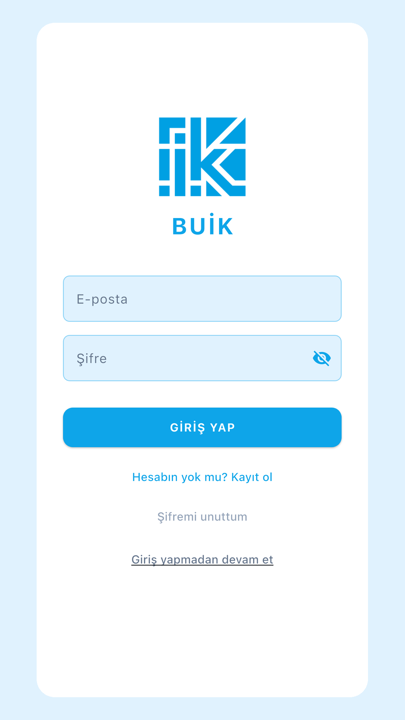
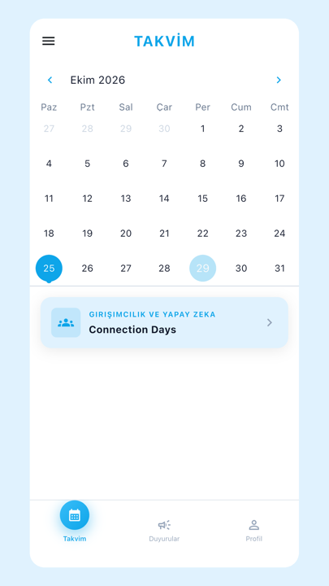
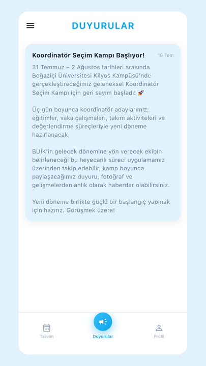

# BUİK App

The official mobile app for **BUİK**, Boğaziçi University's entrepreneurship and business club, which has around 2,000 members. It is live on the iOS App Store and in testing on Google Play.

Members use it to follow events, check in to meetings with a code, apply to programs, and get push notifications. Board members get admin tools for managing events, sponsors, attendance and applications.

<p align="center">
  
  
  
</p>

## Features

- **Event calendar & announcements**, with push notifications and automatic event reminders (Firebase Cloud Messaging and a Supabase Edge Function)
- **Code-based attendance check-in**, with server-side rate limiting against brute-force guessing. It was tested at live meetings with 40+ people on the same Wi-Fi.
- **Role-based access** for member, alumni, coordinator and board, enforced with Postgres Row Level Security. Anyone who signs up with an `@buik.net` address gets the alumni role automatically.
- **Event applications** for members and guests, plus a review dashboard for the board
- **Mentorship program** with mentor profiles
- **Sponsors & gallery**, which the board manages from inside the app
- **Donations** through iyzico checkout (Edge Functions plus a payment callback)
- **Orientation registration & raffle** for new-member events
- **Statistics** on attendance and member activity
- **Google Drive sync**: attendance is mirrored to a Google Sheet automatically with Apps Script
- **Account deletion**, as App Store rules require

## Tech stack

| Layer | Tech |
|---|---|
| Mobile | Flutter (Dart), iOS and Android |
| Backend | Supabase: Postgres, Auth, RLS, Storage, Edge Functions (Deno/TypeScript) |
| Notifications | Firebase Cloud Messaging and flutter_local_notifications |
| Payments | iyzico |
| Automation | Google Apps Script (Drive/Sheets sync) |
| Testing | Flutter widget tests and integration tests |

## Project structure

```
lib/
  screens/      UI: calendar, attendance, applications, profile, admin tools…
  services/     Supabase + notification services
  models/  widgets/  theme/  config/
supabase/
  phase*.sql    Incremental schema, RLS policies and RPC functions
  functions/    Edge Functions (payments, notifications, reminders)
apps_script/    Attendance → Google Sheets sync
integration_test/
```

## Running locally

1. Create a Supabase project and run the SQL files in `supabase/` in order.
2. Copy `env.example.json` to `env.json` and fill in your Supabase URL and publishable key.
3. Add your own Firebase config files. Templates are in `android/app/google-services.example.json` and `ios/Runner/GoogleService-Info.example.plist`.
4. Run:

```bash
flutter pub get
flutter run --dart-define-from-file=env.json
```

> This public repository is a cleaned showcase copy. Real credentials, member data and deployment config are not included.
